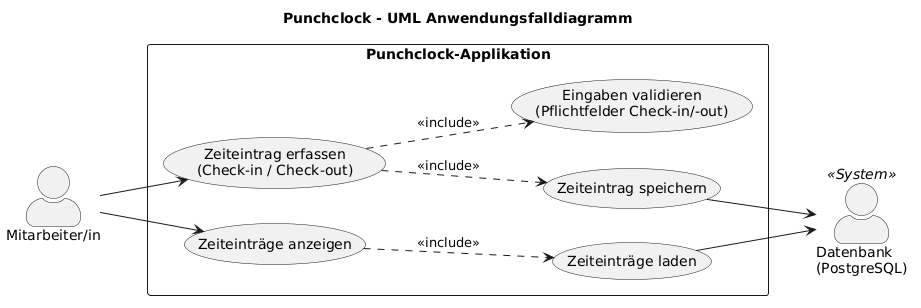
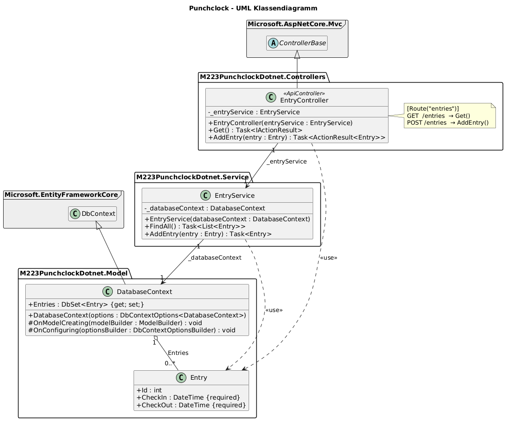
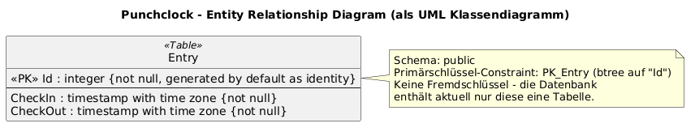
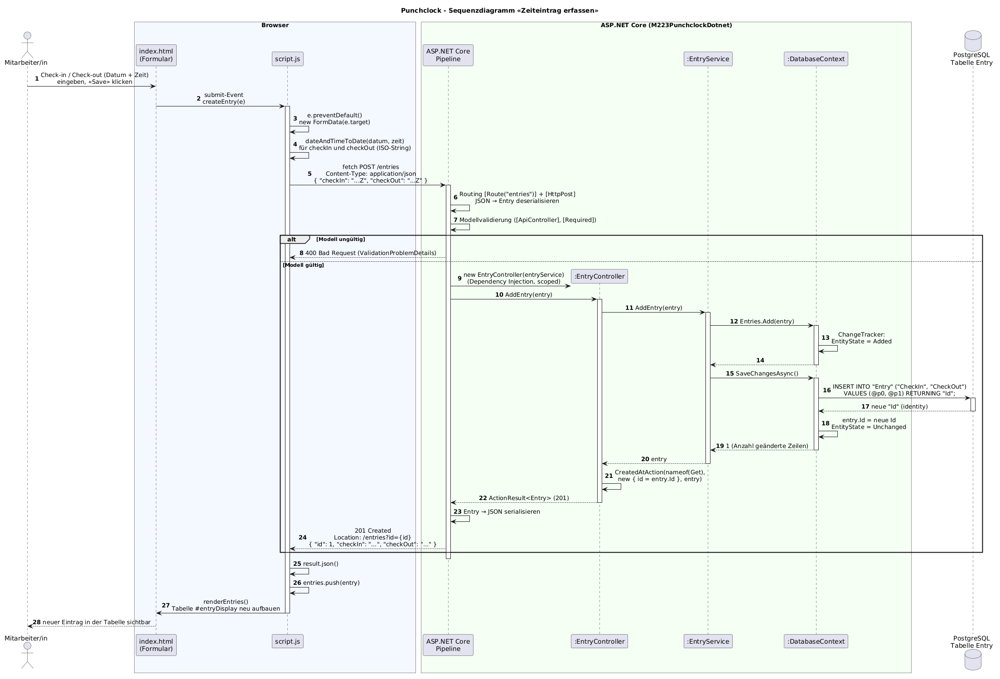
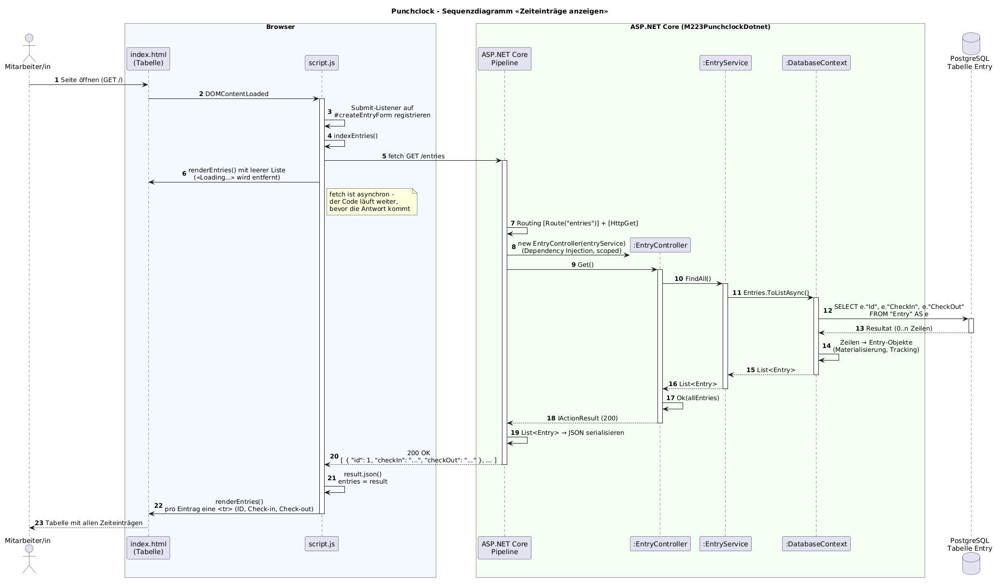

# Diagramme – M223 Punchclock

Die Quellen liegen als PlantUML (`*.puml`) vor, gerendert als PNG und SVG.

## 1. UML Anwendungsfalldiagramm



| Anwendungsfall | Umsetzung |
| --- | --- |
| Zeiteintrag erfassen | Formular in `wwwroot/index.html` → `POST /entries` → `EntryController.AddEntry()` |
| Zeiteinträge anzeigen | Tabelle in `wwwroot/index.html` → `GET /entries` → `EntryController.Get()` |
| Eingaben validieren | `required` im Formular, `[Required]` auf `Entry.CheckIn` / `Entry.CheckOut` |
| Zeiteintrag speichern / laden | `EntryService` → `DatabaseContext` (EF Core) → PostgreSQL |

## 2. UML Klassendiagramm



Schichten: `Controllers` (REST-API) → `Service` (Geschäftslogik) → `Model` (EF-Core-Kontext und Entität).
Die Abhängigkeiten werden per Dependency Injection im Konstruktor übergeben (`Program.cs`).

## 3. Entity Relationship Diagram (als UML Klassendiagramm)



Das ERD bildet die tatsächliche Tabelle in der Datenbank ab. Ausgelesen wurde sie gemäss `readme.md`
über PgAdmin (http://localhost:5050 → Server `db` → Schemas → public → Tables) bzw. direkt mit:

```bash
docker exec m223-punchclock-bretscherjan_devcontainer-db-1 psql -U postgres -d postgres -c '\d "Entry"'
```

| Spalte | Typ | Nullable | Default |
| --- | --- | --- | --- |
| Id | integer | not null | generated by default as identity |
| CheckIn | timestamp with time zone | not null | |
| CheckOut | timestamp with time zone | not null | |

Index: `PK_Entry` PRIMARY KEY, btree (`Id`). Es gibt (noch) keine weiteren Tabellen und damit keine Beziehungen.

## 4. Sequenzdiagramme

Beide zeigen den vollständigen Weg vom Browser über ASP.NET Core, Service und EF Core bis zur
PostgreSQL-Datenbank und zurück.

### Anwendungsfall «Zeiteintrag erfassen» (`POST /entries`)



- Das Formular wird in `script.js` (`createEntry`) abgefangen, Datum und Zeit werden zu ISO-Strings kombiniert.
- ASP.NET Core deserialisiert das JSON zu `Entry` und validiert es (`[ApiController]` + `[Required]`);
  bei ungültigem Modell antwortet es automatisch mit `400`, ohne den Controller aufzurufen.
- `SaveChangesAsync()` erzeugt ein `INSERT ... RETURNING "Id"`; EF Core schreibt die neue Id in das Objekt zurück.
- `CreatedAtAction` liefert `201 Created` mit dem gespeicherten Eintrag; das Frontend hängt ihn an die Liste und rendert die Tabelle neu.

### Anwendungsfall «Zeiteinträge anzeigen» (`GET /entries`)



- Wird beim Laden der Seite (`DOMContentLoaded` → `indexEntries()`) ausgelöst.
- `ToListAsync()` erzeugt ein `SELECT` auf die Tabelle `Entry`; das Resultat geht als JSON-Array zurück.
- Da `fetch` asynchron ist, ruft `indexEntries()` `renderEntries()` sofort einmal mit leerer Liste auf und ein zweites Mal, wenn die Daten da sind.

## Neu rendern

```bash
docker run --rm -v "$(pwd):/data" -w /data plantuml/plantuml -tpng -charset UTF-8 *.puml
```
